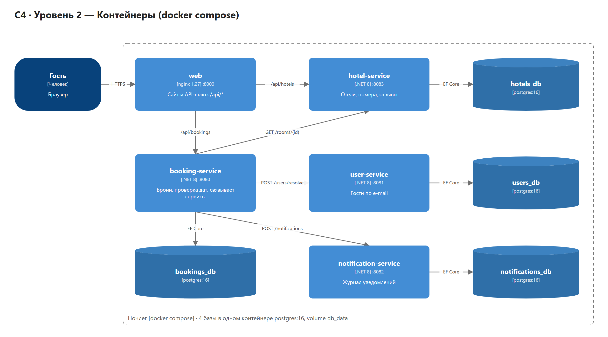

# Ночлег — микросервисный сервис бронирования отелей

Учебный проект: сайт для поиска и бронирования номеров в отелях, разбитый на независимые сервисы.
**.NET 8 · PostgreSQL 16 · Docker Compose · nginx.**

Разработчики: **Евгения Диколенко, Дмитрий Морозов**.

**Демо:** https://bookingtemp.gruu.net (временный стенд)



---

## Идея и минимальный сценарий

Гость открывает сайт, выбирает город и даты, смотрит отели с фото, звёздами и отзывами,
выбирает номер и бронирует его. Для брони достаточно ввести **имя и e-mail**: пользователь создаётся сам.
Потом гость может открыть «Мои брони» по e-mail и отменить бронь.

Что происходит при бронировании (`POST /api/bookings`):

1. **web** (nginx) принимает запрос и передаёт его в **booking-service**.
2. **booking-service** спрашивает у **hotel-service** номер: цену и вместимость.
3. **booking-service** проверяет в своей базе, что даты не пересекаются с другими бронями.
   Проверка и запись идут в одной транзакции с `pg_advisory_xact_lock`, поэтому двойной брони не будет.
4. **booking-service** вызывает **user-service**: найти гостя по e-mail или создать нового.
5. Бронь сохраняется в `bookings_db`, а **notification-service** записывает уведомление «Бронь подтверждена».

## Сервисы

| Сервис | Папка | Порт | Отвечает за | База |
|---|---|---|---|---|
| **web** | `web/` | 8000 | Сайт (HTML/CSS/JS) и API-шлюз: `/api/*` → сервисы | — |
| **booking-service** | `booking-service/` | 8080 | Брони, проверка дат, связывает остальные сервисы | `bookings_db` |
| **hotel-service** | `hotel-service/` | 8083 | Отели, номера, отзывы (стартовые данные создаются сами) | `hotels_db` |
| **user-service** | `user-service/` | 8081 | Гости: поиск или создание по e-mail | `users_db` |
| **notification-service** | `notification-service/` | 8082 | Журнал уведомлений (подтверждение и отмена) | `notifications_db` |
| **db** | `db/` | 5432 | PostgreSQL 16, volume **`db_data`** | 4 базы |

У каждого сервиса своя папка, свой `Dockerfile` и своя база (принцип *database per service*).
Все 4 базы лежат в одном контейнере `postgres:16`; создаёт их скрипт `db/init.sql`.

### Как сервисы общаются

```
браузер ──► web (nginx :8000) ──► /api/hotels ───────────► hotel-service :8083 ──► hotels_db
                               ├► /api/bookings ─────────► booking-service :8080 ─► bookings_db
                               │                              ├─ GET  /rooms/{id}      ► hotel-service
                               │                              ├─ POST /users/resolve   ► user-service ──► users_db
                               │                              └─ POST /notifications   ► notification-service ──► notifications_db
                               ├► /api/users ────────────► user-service :8081
                               └► /api/notifications ────► notification-service :8082
```

## Запуск

Нужны Docker Engine (или Docker Desktop) и Docker Compose.

```bash
git clone <ссылка на репозиторий>
cd BookingService
docker compose up -d --build
```

Первый запуск собирает образы, это займёт несколько минут. Потом:

- сайт: **http://localhost:8000**
- сервисы напрямую: `http://localhost:8080` (booking), `:8081` (user), `:8082` (notification), `:8083` (hotel)

Проверить, что всё поднялось:

```bash
docker compose ps
```

Все сервисы должны быть в статусе `healthy`. Остановить систему:

```bash
docker compose down
```

С флагом `-v` удалятся и данные:

```bash
docker compose down -v
```

Логин и пароль PostgreSQL по умолчанию `postgres` / `postgres`.
Их можно поменять переменными `POSTGRES_USER` и `POSTGRES_PASSWORD` в файле `.env`.

## API

Через шлюз всё доступно с префиксом `/api`, например `http://localhost:8000/api/hotels`.

**hotel-service**
- `GET /hotels?city=&minStars=&maxPrice=&sort=rating|price|-price|stars`: список отелей
- `GET /hotels/cities`: города
- `GET /hotels/{id}`: отель, его номера и отзывы
- `GET /rooms/{id}`: номер (этим пользуется booking-service)
- `POST /hotels`: добавить отель

**booking-service**
- `POST /bookings`: создать бронь. Тело: `{ roomId, checkIn, checkOut, guests, name, email }`
- `GET /bookings`, `GET /bookings?email=`, `GET /bookings/{id}`
- `POST /bookings/{id}/cancel`: отменить
- `GET /availability?hotelId=&checkIn=&checkOut=`: занятые номера

**user-service**
- `POST /users/resolve`: найти или создать гостя по `{ name, email }`
- `GET /users`, `GET /users/{id}`, `GET /users/by-email?email=`

**notification-service**
- `POST /notifications`, `GET /notifications?email=`

У каждого сервиса есть `GET /health`.

Коды ответов: `201` бронь создана, `400` неверные даты или данные, `404` нет номера или брони,
`409` номер уже занят на эти даты, `503` нужный сервис недоступен.

## Проверка

**curl:** весь сценарий одним скриптом (health → отели → бронь → повторная бронь 409 → гость → уведомление → отмена):

```bash
bash scripts/demo.sh
```

По умолчанию скрипт ходит в `http://localhost:8000/api`. Другой адрес задаётся так:

```bash
BASE=http://localhost:8000/api bash scripts/demo.sh
```

**Postman:** импортировать `docs/postman_collection.json` (запросы к каждому сервису по его порту).

**Одиночные запросы:**

```bash
curl http://localhost:8083/hotels/1
```

```bash
curl -X POST http://localhost:8080/bookings -H "Content-Type: application/json" \
  -d '{"roomId":1,"checkIn":"2026-12-20","checkOut":"2026-12-23","guests":2,"name":"Студент","email":"student@example.com"}'
```

```bash
curl "http://localhost:8082/notifications?email=student@example.com"
```

**Данные сохраняются после перезапуска:**

```bash
docker compose down
```

```bash
docker compose up -d
```

```bash
curl http://localhost:8080/bookings
```

Брони на месте: они лежат в volume `db_data`.

### Вывод команд для защиты

Папка `docs/outputs/`:
- `01-compose-up.txt`: `docker compose down` / `up -d`
- `02-compose-ps.txt`: `docker compose ps`, все 6 контейнеров `healthy`, volume `db_data`
- `03-api-scenario.txt`: полный вывод `scripts/demo.sh`
- `04-persistence.txt`: таблицы `Bookings` и `Users` до и после перезапуска

Вывод снят на развёрнутой копии. Там добавлен файл `deploy/docker-compose.server.yml`,
который привязывает порты только к 127.0.0.1, поэтому в командах есть флаги `-p` и `-f`.

## Архитектура (C4)

- `docs/architecture.drawio`: редактируемая схема, 3 страницы (открывается в diagrams.net)
- `docs/architecture.png`: экспорт всех трёх уровней одной картинкой
- `docs/c4-1-context.png`: **Context**, система и пользователи
- `docs/c4-2-container.png`: **Container**, сервисы, шлюз и базы
- `docs/c4-3-component.png`: **Component**, устройство booking-service

## Структура

```
booking-service/        Program.cs, BookingService.csproj, Dockerfile
hotel-service/          Program.cs (+ стартовые отели и отзывы), Dockerfile
user-service/           Program.cs, Dockerfile
notification-service/   Program.cs, Dockerfile
web/                    Dockerfile, nginx.conf, site/ (index.html, styles.css, app.js, img/)
db/init.sql             создание 4 баз
docker-compose.yml
scripts/demo.sh         сценарий проверки через curl
deploy/                 добавка для сервера (порты на 127.0.0.1)
docs/                   C4, Postman, вывод команд, old/ — ранние материалы проекта
```

Фото отелей взяты с Unsplash (бесплатная лицензия). Отели, отзывы и брони вымышленные.
